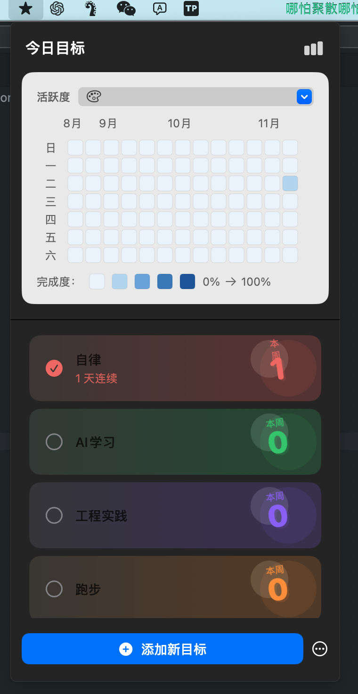
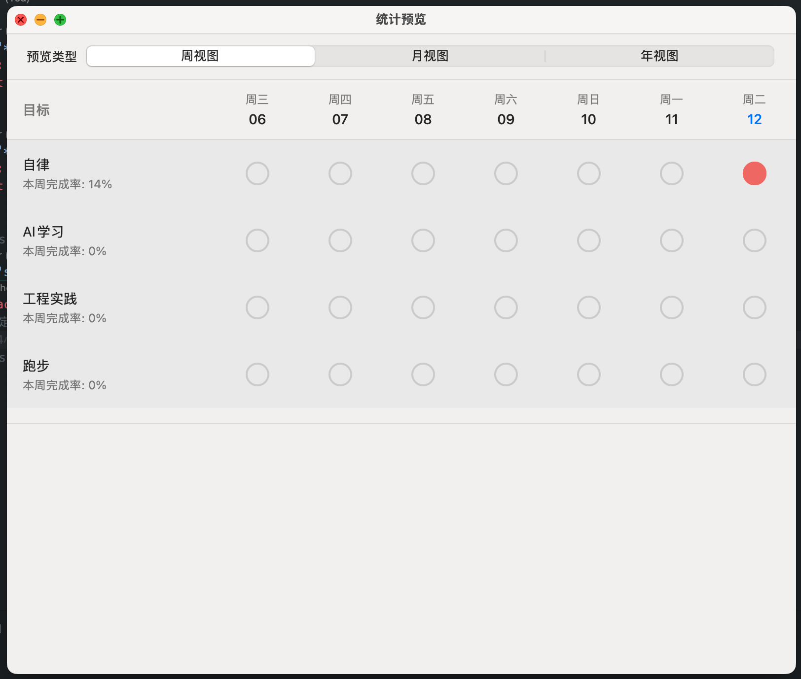
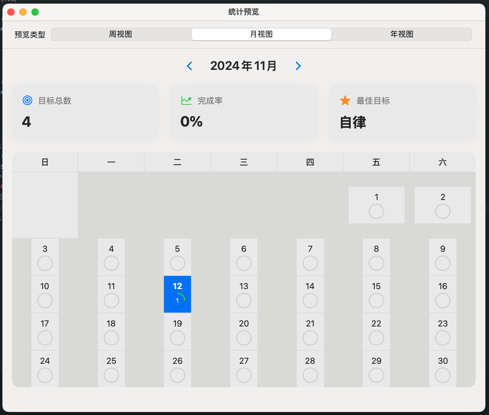
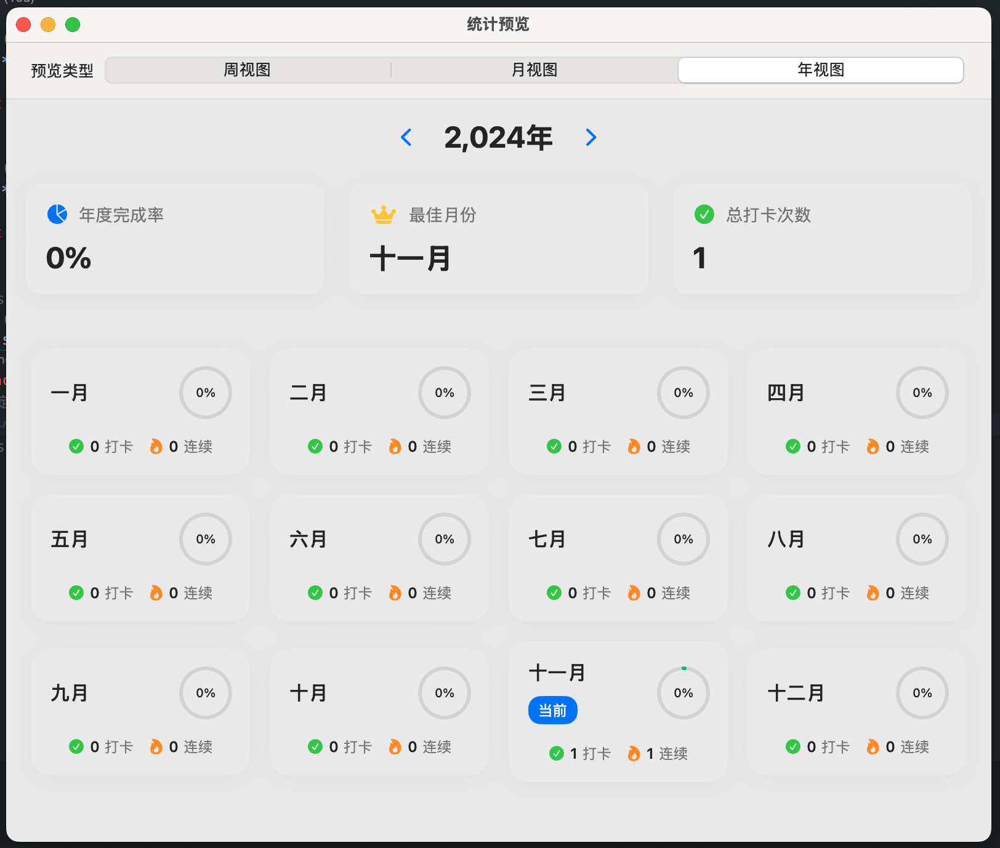

# 轨迹


轨迹，一个 macOS 目标管理应用（菜单栏 / MenuBarExtra）。

## 环境要求

- macOS 14.0（Sonoma）或更高版本
- Xcode 16.0 或更高版本（Swift 5 语言模式）
- 无需 CocoaPods / SPM 第三方依赖（纯系统框架：SwiftUI + AppKit）

## 本地运行（开发）

1. 克隆仓库：
   ```bash
   git clone https://github.com/Hao-yiwen/reminder_app.git
   cd reminder_app
   ```
2. 用 Xcode 打开工程：
   ```bash
   open reminder_app.xcodeproj
   ```
3. 在 Xcode 中选择 scheme `reminder_app`，目标设备选 **My Mac**。
4. 如需真机签名，在 Signing & Capabilities 中选择你的 Development Team（或改为个人签名）。
5. 按 `⌘R` 运行。应用为菜单栏应用（`LSUIElement = YES`），Dock 中通常不可见，请在状态栏查找星标图标。

## 下载安装

[下载最新版本](https://github.com/Hao-yiwen/reminder_app/releases/)

## 功能特点

### 📌 简洁的状态栏体验

- 常驻状态栏，随时可用
- 简洁优雅的界面设计
- 点击即可快速查看和添加目标

### 🎯 目标管理

- 支持添加多个目标任务
- 每个目标独立的色彩标识
- 右键支持快速删除目标

### ✅ 打卡追踪

- 简单点击完成每日打卡
- 实时显示连续打卡天数
- 优雅的渐变色彩显示打卡进度
- 打卡天数越多，颜色越鲜艳

### 📊 数据统计

- 支持周/月/年三种统计视图
- 直观展示完成情况
- 圆形进度条展示月度完成率
- 详细的历史记录查看

### 🔄 其他特性

- 数据本地持久化存储
- 流畅的动画过渡效果
- 支持深色模式
- 极简的操作体验

### 🎨 个性化显示

- 每个目标独特的渐变色彩方案
- 连续打卡带来的视觉反馈
- 清晰的目标完成状态展示

## 常见问题

如果提示"无法打开应用程序"，请尝试：

1. 右键点击应用选择"打开"
2. 在系统设置的安全性与隐私中允许打开
3. 如果仍然无法打开，请在终端中运行：

```bash
xattr -cr /Applications/reminder_app.app
```

## 系统要求

macOS 14.0 或更高版本

## 预览









## 支持我的工作

如果这个项目对你有帮助，可以请我喝杯咖啡 ☕️

<details>
<summary>
  
</summary>
<br>

</details>
